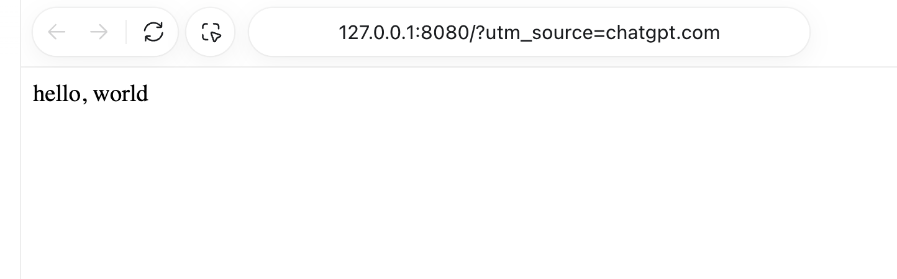
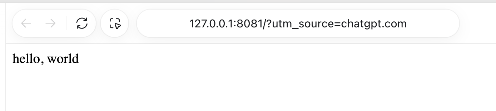
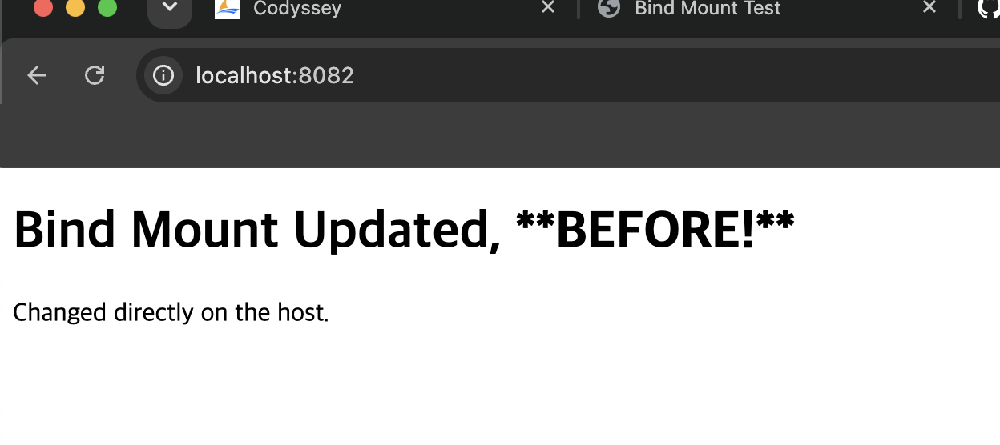
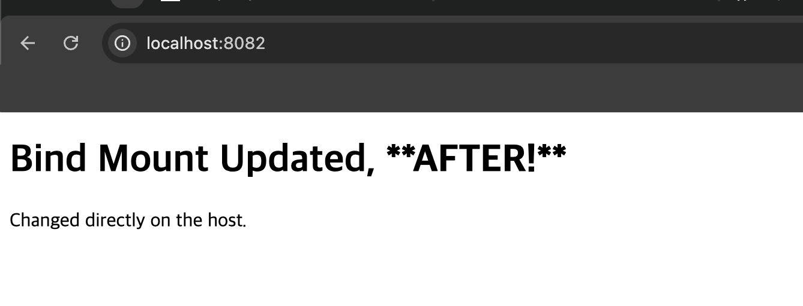
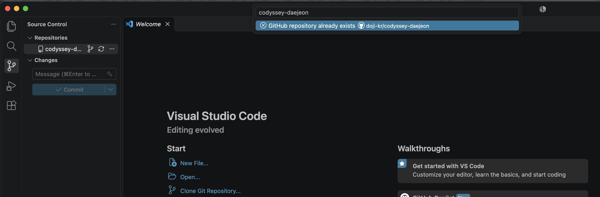

# Developer Workstation

## 1. 프로젝트 개요

Linux CLI, Docker, Git/GitHub를 이용하여
재현 가능한 개발 워크스테이션을 구축합니다.

NGINX 웹 서버를 커스텀 Docker 이미지로 만들고,
포트 매핑, 바인드 마운트, 볼륨 영속성을 검증합니다.

같은 결과를 처음부터 다시 만드는 절차는 [RUNBOOK.md](RUNBOOK.md)에 있습니다.

## 2. 실행 환경

- OS: macOS 15.4.1 (Apple Silicon)
- Shell: zsh 5.9
- Terminal: Warp
- Docker: 29.6.1
- Git: 2.39.5 (Apple Git-154)
- Container Runtime: Docker Desktop

서울캠퍼스 추가 안내의 OrbStack 대신 Docker Desktop을 사용했습니다. `docker` 명령은 동일하게 동작합니다.

## 3. 수행 체크리스트

- [x] 터미널 기본 조작
- [x] 파일 및 디렉토리 권한
- [x] Docker 설치 및 엔진 점검
- [x] Docker 운영 명령 (이미지, 실행, 중지, 로그, 리소스)
- [x] hello-world, Ubuntu 컨테이너, attach/exec 비교
- [x] Dockerfile 기반 커스텀 이미지
- [x] 포트 8080/8081 접속
- [x] 바인드 마운트 변경 반영
- [x] Docker 볼륨 데이터 영속성
- [x] Git 설정 및 GitHub 저장소 연동
- [ ] VS Code GitHub 로그인 화면 캡처
- [x] 트러블슈팅 2건 이상

## 4. 프로젝트 구성

- `Dockerfile`: NGINX 기반 커스텀 이미지
- `site/`: 이미지에 포함되는 정적 HTML 웹페이지
- `practice/`: 터미널과 파일 권한 실습
- `logs/`: 실제 명령어 및 실행 결과
- `evidence/`: 스크린샷 증거
- `scripts/tty.exp`: 대화형 컨테이너 실습의 입력 자동화
- `RUNBOOK.md`: 전체 재현 절차

`site-live/`는 바인드 마운트 실습 중 호스트에서 수정하는 폴더입니다. `.gitignore` 대상이므로 런북에서 직접 만듭니다.

## 5. 커스텀 이미지

방식 (A)를 선택했습니다. 베이스 이미지는 `nginx:stable-alpine`입니다. 웹 서버 설치와 설정을 직접 하지 않아도 되고 이미지가 작습니다.

```dockerfile
FROM nginx:stable-alpine

LABEL org.opencontainers.image.title="dev-workstation"

COPY site/ /usr/share/nginx/html/

EXPOSE 80
```

| 커스텀 포인트 | 목적 |
|---|---|
| `LABEL` | 이미지의 이름과 용도를 메타데이터로 남김 |
| `COPY site/` | 기본 페이지를 직접 작성한 콘텐츠로 교체 |
| `EXPOSE 80` | 컨테이너가 사용하는 포트를 문서화 (실제 공개는 `-p`로 지정) |

### 빌드 및 실행

```bash
docker build -t workshop-web:1.0 .
docker run -d --name workshop-web-8080 -p 127.0.0.1:8080:80 workshop-web:1.0
docker run -d --name workshop-web-8081 -p 127.0.0.1:8081:80 workshop-web:1.0
curl -i http://127.0.0.1:8080
```

호스트 포트를 `127.0.0.1`에 묶어 이 컴퓨터에서만 접속할 수 있게 했습니다.

## 6. 검증 방법과 결과

| 검증 항목 | 명령 | 확인한 내용 | 결과 |
|---|---|---|---|
| CLI 기본 조작 | `pwd`, `ls -la`, `cd`, `mkdir`, `cp`, `mv`, `rm`, `cat`, `touch` | 이동, 생성, 복사, 이름 변경, 삭제 | [로그](logs/01-cli.txt) |
| 권한 변경 | `chmod`, `ls -l`, `ls -ld` | 파일과 디렉토리 권한의 전후 비교 | [로그](logs/02-permissions.txt) |
| Docker 점검 | `docker --version`, `docker info` | 버전, 데몬 동작, 런타임 | [로그](logs/03-docker.txt) |
| 컨테이너 실습 | `docker run`, `docker exec`, `docker attach` | hello-world, Ubuntu 내부 명령, 종료/유지 차이 | [로그](logs/03-docker.txt) |
| 웹 서버 실행 | `docker build`, `curl -i`, `docker logs`, `docker stats`, `docker stop` | 빌드, 포트 접속, 로그, 리소스, 중지/시작 | [로그](logs/04-web.txt) |
| 바인드 마운트 | `docker run --mount type=bind`, `curl` | 호스트 변경의 즉시 반영 | [로그](logs/05-bind.txt) |
| 볼륨 영속성 | `docker volume`, `docker rm -f`, `docker exec` | 컨테이너 삭제 후 데이터 유지 | [로그](logs/06-volume.txt) |
| Git 연동 | `git config --list`, `git remote -v`, `gh repo view` | 사용자 정보, 기본 브랜치, 원격 저장소 | [로그](logs/07-git.txt) |
| 트러블슈팅 | `curl`, `docker port`, `docker ps -a` | 실패 재현, 원인 확인, 해결 | [로그](logs/08-troubleshooting.txt) |

공개 저장소이므로 `docker info`, `docker images`, `docker ps -a`의 출력은 이번 실습 항목으로 한정했고, `git config --list`의 이메일은 마스킹했습니다.

### 터미널과 권한

```text
$ cp practice/demo/note.txt practice/demo/copy.txt
$ mv practice/demo/copy.txt practice/demo/renamed.txt
$ cat practice/demo/renamed.txt
Hello, Linux CLI
$ chmod 600 practice/demo/note.txt
$ ls -l practice/demo/note.txt
-rw-------@ 1 doji  staff  17 Nov  5 18:57 practice/demo/note.txt
$ chmod 700 practice/demo
$ ls -ld practice/demo
drwx------@ 4 doji  staff  128 Nov  5 18:57 practice/demo
```

`600`과 `700`으로 소유자 외의 접근을 막아 권한 표기가 바뀌는 것을 확인한 뒤, 일반적인 값인 `644`와 `755`로 복원했습니다.

### Docker 점검

```text
$ docker --version
Docker version 29.6.1, build 8900f1d330
$ docker info --format "Server Version: {{.ServerVersion}} | Operating System: {{.OperatingSystem}} | OSType: {{.OSType}} | Architecture: {{.Architecture}} | CPUs: {{.NCPU}}"
Server Version: 29.6.1 | Operating System: Docker Desktop | OSType: linux | Architecture: aarch64 | CPUs: 10
```

### 컨테이너 종료와 유지

| 방법 | `exit` 또는 해제 후 상태 | 이유 |
|---|---|---|
| `docker run -it ... bash` 후 `exit` | `Exited (0)` | 컨테이너의 주 프로세스인 bash가 끝남 |
| `docker exec -it ... bash` 후 `exit` | `Up` | exec로 추가한 프로세스만 끝나고 주 프로세스는 유지됨 |
| `docker attach` 후 Ctrl+P, Ctrl+Q | `Up` | 주 프로세스를 끝내지 않고 연결만 해제함 |
| `docker attach` 후 `exit` | `Exited (0)` | attach는 주 프로세스에 연결되므로 bash가 끝남 |

### 포트 매핑

```text
$ curl -i -s http://127.0.0.1:8080
HTTP/1.1 200 OK
Server: nginx/1.30.6
...
hello, world
$ curl -i -s http://127.0.0.1:8081
HTTP/1.1 200 OK
Server: nginx/1.30.6
...
hello, world
```





### 바인드 마운트

호스트 파일만 수정했고, 재빌드와 컨테이너 재시작은 하지 않았습니다.

```text
$ docker run -d --name workshop-bind -p 127.0.0.1:8082:80 --mount type=bind,source="$PWD/site-live",target=/usr/share/nginx/html,readonly workshop-web:1.0
$ curl -s http://127.0.0.1:8082
    <h1>Bind Mount Updated, <b>**BEFORE!**</b></h1>
$ perl -pi -e "s/BEFORE/AFTER/" site-live/index.html
$ curl -s http://127.0.0.1:8082
    <h1>Bind Mount Updated, <b>**AFTER!**</b></h1>
```





### 볼륨 영속성

```text
$ docker volume create workshop-data
$ docker run -d --name workshop-volume-1 --mount type=volume,source=workshop-data,target=/data ubuntu:24.04 sleep infinity
$ docker exec workshop-volume-1 sh -c "echo Docker persistent data! > /data/hello.txt"
$ docker exec workshop-volume-1 cat /data/hello.txt
Docker persistent data!
$ docker rm -f workshop-volume-1
$ docker run -d --name workshop-volume-2 --mount type=volume,source=workshop-data,target=/data ubuntu:24.04 sleep infinity
$ docker exec workshop-volume-2 cat /data/hello.txt
Docker persistent data!
```

### Git / GitHub / VS Code

```text
$ git config --list | sed -E "s/^(user\.email=).*/\1<masked>/"
init.defaultbranch=main
user.email=<masked>
user.name=doji
remote.origin.url=https://github.com/doji-kr/codyssey-daejeon.git
...
$ gh repo view --json nameWithOwner,visibility,url,defaultBranchRef
{"defaultBranchRef":{"name":"main"},"nameWithOwner":"doji-kr/codyssey-daejeon","url":"https://github.com/doji-kr/codyssey-daejeon","visibility":"PUBLIC"}
```



## 7. 트러블슈팅

### 사례 1: 컨테이너가 실행 중인데 접속되지 않음

- 로그: [`logs/08-troubleshooting.txt`](logs/08-troubleshooting.txt)의 첫 번째 `docker run`부터 `curl -i -s http://127.0.0.1:8099`까지
- 문제: `curl`이 `Failed to connect to 127.0.0.1 port 8099`로 실패했습니다.
- 원인 가설: 웹 서버가 죽었거나, 호스트 포트가 컨테이너에 연결되지 않았습니다.
- 확인 명령: `docker ps`, `docker port workshop-debug-port`, `docker exec workshop-debug-port wget -qO- http://127.0.0.1:80`
- 확인 결과: 컨테이너는 `Up`이고 내부 응답은 `hello, world`였습니다. 포트는 `80/tcp`만 보이고 `docker port`의 출력이 없어 호스트 연결이 없었습니다.
- 해결: 컨테이너를 삭제하고 `-p 127.0.0.1:8099:80`을 넣어 다시 실행했습니다.
- 검증 결과: `curl -i`가 `HTTP/1.1 200 OK`와 `hello, world`를 반환했습니다.

### 사례 2: 컨테이너 이름 충돌

- 로그: [`logs/08-troubleshooting.txt`](logs/08-troubleshooting.txt)의 `Conflict` 오류부터 `curl -s http://127.0.0.1:8100`까지
- 문제: `docker run`이 `Conflict. The container name "/workshop-debug-port" is already in use`로 실패했습니다.
- 원인 가설: 같은 이름의 컨테이너가 이미 있습니다.
- 확인 명령: `docker ps -a --filter name=workshop-debug-port`
- 확인 결과: 같은 이름의 컨테이너가 `Up` 상태로 8099 포트를 사용 중이었습니다.
- 해결: `docker rm -f workshop-debug-port`로 삭제하고 8100 포트로 다시 실행했습니다.
- 검증 결과: `curl -s http://127.0.0.1:8100`이 `hello, world`를 반환했습니다.

## 8. 학습 내용

### 이미지와 컨테이너의 차이

이미지는 실행에 필요한 파일과 설정을 묶은 읽기 전용 템플릿이고, 컨테이너는 그 이미지로 실행한 격리된 프로세스입니다. 이번 실습에서는 `workshop-web:1.0` 이미지 하나로 8080과 8081 컨테이너를 따로 실행했습니다.

### 파일 권한 755와 644

`r`은 읽기(4), `w`는 쓰기(2), `x`는 실행(1)이고, 세 자리 숫자는 소유자, 그룹, 기타 사용자 순서의 합입니다.

- `755`는 `rwxr-xr-x`입니다. 소유자만 수정할 수 있고 나머지는 읽기와 실행이 가능합니다. 디렉토리에서 `x`는 안으로 들어갈 수 있는 권한입니다.
- `644`는 `rw-r--r--`입니다. 소유자만 수정할 수 있고 나머지는 읽기만 가능합니다.

### 절대 경로와 상대 경로

절대 경로는 루트(`/`)부터 적는 경로이고 현재 위치와 상관없이 같은 곳을 가리킵니다. 예: `/Users/doji/codyssey-daejeon/practice`. 상대 경로는 현재 위치를 기준으로 합니다. 예: `practice/demo`에서 `cd ../..`를 실행하면 저장소 루트로 돌아갑니다.

### 포트 매핑의 필요성

컨테이너는 격리된 네트워크를 쓰므로 내부 포트에 호스트에서 바로 접속할 수 없습니다. `-p 8080:80`은 호스트의 8080을 컨테이너의 80으로 연결합니다. 호스트 포트만 다르게 주면 같은 이미지를 동시에 여러 개 실행할 수 있습니다. 사례 1이 `-p`가 없을 때의 결과입니다.

호스트 주소를 지정한 `-p 127.0.0.1:8080:80`은 이 컴퓨터에서만 접속할 수 있습니다. 주소를 생략한 `-p 8080:80`은 모든 네트워크 인터페이스에 열려 방화벽이 막지 않으면 같은 네트워크의 다른 기기에서도 접속할 수 있습니다.

### 바인드 마운트와 볼륨의 차이

바인드 마운트는 호스트의 특정 폴더를 컨테이너에 연결하므로 개발 중 수정 내용을 바로 확인할 때 적합합니다. 볼륨은 Docker가 관리하는 저장 공간으로 컨테이너의 수명과 분리되므로 데이터 보존에 적합합니다. 컨테이너를 삭제해도 `workshop-data`의 파일은 남았습니다.

### Git과 GitHub의 차이

Git은 내 컴퓨터에서 변경 이력을 관리하는 버전 관리 도구입니다. GitHub는 Git 저장소를 원격으로 호스팅하며 공유와 협업 기능을 제공하는 플랫폼입니다.

## 9. 재현 및 주의사항

- 전체 절차와 기대 결과는 [RUNBOOK.md](RUNBOOK.md)에 있습니다. 컨테이너 ID, 시각, 크기는 실행마다 달라집니다.
- Docker Desktop이 실행 중이어야 합니다.
- 사용 중인 포트라면 다른 호스트 포트를 지정합니다.
- 바인드 마운트는 `$PWD`를 사용하므로 저장소 위치에 묶이지 않습니다. 다만 저장소 경로가 Docker Desktop의 File Sharing 범위 안에 있어야 합니다.
- 토큰, 개인키, 비밀번호는 커밋하지 않습니다.
